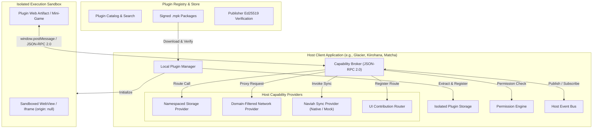

# Universal Plugin Ecosystem

> **Current Status:** `ALL PHASES (0-8) COMPLETED & VERIFIED`  
> **Target Subsystem:** Universal Plugin Ecosystem (`plugins/`)  
> **Stability:** Production-Ready Reference Implementation / 100% Automated Conformance & Penetration Passing

---

## 1. Project Purpose

The **Universal Plugin Ecosystem** provides a secure, modular, technology-neutral extension architecture for the Miyuna community platform. It allows third-party developers, community creators, and official teams to extend the platform with optional features—including embedded mini-games, self-hosted media connectors (e.g., Jellyfin/Plex), dashboard widgets, and optional device synchronization capabilities (e.g., Naviah Sync)—without altering the core microservice architecture or compromising client security.

---

## 2. Problem Statement

The platform operates across multiple official client applications implemented with distinct technology stacks:
- **Glacier**: Modern Web client ([React](file:///c:/Users/Ananda/Documents/Coding/Miyuna/apps/open-source/client/Glacier/package.json), Vite, TypeScript)
- **Hanatsuki**: Desktop / Web client ([React](file:///c:/Users/Ananda/Documents/Coding/Miyuna/apps/open-source/client/Hanatsuki/package.json), Vite, TypeScript)
- **Kiirohana**: Hybrid mobile client ([Apache Cordova](file:///c:/Users/Ananda/Documents/Coding/Miyuna/apps/open-source/client/Kiirohana/package.json), Vite)
- **Matcha**: Mobile client ([React Native / Expo](file:///c:/Users/Ananda/Documents/Coding/Miyuna/apps/open-source/client/Matcha/package.json))
- **Cactus**: Native / upcoming client platform

Historically, extensions risk tight coupling to a specific frontend framework or client runtime, resulting in fragmented feature availability, duplicated extension codebases, or security risks where plugins execute with excessive host privileges. The platform requires a unified contract layer so plugins can be written once, distributed safely, and hosted consistently across all official clients.

---

## 3. Scope and Non-Goals

### In Scope
- Specification of platform-neutral plugin manifests (`plugin.json`) and packaging conventions (`.mpk`).
- Sandboxed UI hosting protocols for embedded pages, mini-games, and dashboard widgets.
- The **Capability Broker**: a mediated, permission-checked JSON-RPC 2.0 host bridge.
- External service connector patterns for self-hosted media systems and third-party APIs.
- Optional device capability contracts (including mock and native providers for Naviah Sync).
- Conformance test suites and client adapter specifications.
- Plugin registry, distribution metadata, and digital signature specifications.

### Non-Goals
- **Replacing Core Microservices:** The plugin ecosystem will **not** replace, re-implement, or override core platform microservices (`auth-service`, `user-service`, `media-service`, `group-service`).
- **Universal Native Code Execution:** The ecosystem does **not** allow dynamic loading of arbitrary native binary code (`.so`, `.dylib`, `.dll`) at runtime, in compliance with mobile store guidelines and OS security models.
- **Forcing a Single Client Framework:** The ecosystem does **not** force all clients to migrate to a shared UI framework.
- **Modifying Core Database Schemas:** Plugins maintain their own isolated key-value / file storage and cannot directly query or migrate core platform databases.

---

## 4. Core Platform vs. Optional Plugins

The boundary between mandatory core capabilities and optional extensions is strictly enforced:

```
+--------------------------------------------------------------------------------------------------+
|                                    PLATFORM BOUNDARIES                                           |
+----------------------------------------------------+---------------------------------------------+
| Mandatory Core Platform (Non-Optional)             | Universal Plugin Ecosystem (Optional)       |
+----------------------------------------------------+---------------------------------------------+
| - User Authentication & Account Management         | - Embedded Mini-Games & Interactive Tools   |
| - Authorization & RBAC                             | - Self-Hosted Connectors (Jellyfin / Plex)  |
| - Community Chat & Group Discussions               | - Custom Dashboard & Library Widgets        |
| - Platform Media Catalogs (Anime/Manga/Novels)     | - External Tracking Integrations (AniList)  |
| - Shorts & Video Feeds                             | - Device Sync Operations (Naviah Sync)      |
| - Platform Notifications & Gateway Ingress         | - Custom Workflow Automations               |
+----------------------------------------------------+---------------------------------------------+
| Executed on trusted backend microservices         | Executed in isolated client sandboxes       |
| (Partisier-Rewritten)                              | mediated by the Capability Broker           |
+----------------------------------------------------+---------------------------------------------+
```

---

## 5. Supported Client Technologies

The ecosystem targets the platform's multi-client architecture through technology-neutral contracts:

| Client Name | Directory Path | Stack / Runtime | Primary Extension Host Model |
|---|---|---|---|
| **Glacier** | [`apps/open-source/client/Glacier`](file:///c:/Users/Ananda/Documents/Coding/Miyuna/apps/open-source/client/Glacier) | React 19, Vite, TypeScript | Sandboxed `<iframe>`, `postMessage` Bridge |
| **Hanatsuki** | [`apps/open-source/client/Hanatsuki`](file:///c:/Users/Ananda/Documents/Coding/Miyuna/apps/open-source/client/Hanatsuki) | React, Vite, TypeScript | Sandboxed `<iframe>`, `postMessage` Bridge |
| **Kiirohana** | [`apps/open-source/client/Kiirohana`](file:///c:/Users/Ananda/Documents/Coding/Miyuna/apps/open-source/client/Kiirohana) | Apache Cordova, Vite, TypeScript | Isolated WebView / Cordova Bridge |
| **Matcha** | [`apps/open-source/client/Matcha`](file:///c:/Users/Ananda/Documents/Coding/Miyuna/apps/open-source/client/Matcha) | React Native, Expo | Sandboxed `react-native-webview` Bridge |
| **Cactus** | [`apps/open-source/client/Cactus`](file:///c:/Users/Ananda/Documents/Coding/Miyuna/apps/open-source/client/Cactus) | Native / Kotlin / Upcoming | Platform-native headless / WebView container |

---

## 6. Architectural Principles

1. **Separation of Core and Extensions:** Core platform logic belongs strictly in official microservices. Extensions enhance user experience without creating dependencies in core platform infrastructure.
2. **Platform-Neutral Contracts:** All plugins interact with clients exclusively through declarative manifests, JSON-RPC 2.0 messages, and standard event schemas.
3. **Decoupled Artifacts, Contributions, and Capabilities:** An artifact type (e.g. web bundle), contribution type (e.g. route), and capability (e.g. storage) are treated as orthogonal concepts.
4. **Explicit Permission Enforcement:** Manifest requests are not grants. The host runtime verifies and enforces permissions on every brokered call.
5. **Centralized Capability Broker:** All host and native access passes through a single broker that audits, throttles, and routes invocations. Direct host memory access is strictly prohibited.
6. **Graceful Capability Degradation:** If a client does not implement a native feature (e.g., local network discovery on Web), the broker returns an explicit `UNSUPPORTED` status rather than causing an unhandled failure.
7. **Least Privilege & Sandboxed Isolation:** Untrusted code runs in sandboxed environments with opaque origins, restricted network egress, and isolated namespaced storage.

---

## 7. High-Level Architecture



---

## 8. Main Subsystems and Responsibilities

### 8.1 Package & Manifest System
- Manages the packaging format ([`.mpk` ZIP archive](file:///c:/Users/Ananda/Documents/Coding/Miyuna/plugins/docs/adr/0001-plugin-manifest-and-package-format.md)) containing `plugin.json`, `checksums.json`, and static dist assets.
- Validates manifests against the canonical JSON Schema draft.

### 8.2 Local Plugin Manager
- Handles the plugin lifecycle: `INSTALL` -> `ACTIVATE` -> `DEACTIVATE` -> `UNINSTALL` -> `UPDATE`.
- Enforces path-traversal protections (anti-Zip Slip) during archive extraction.
- Persists per-plugin configuration, grant states, and execution metrics.

### 8.3 Execution Sandbox & UI Integration
- Isolates plugin DOM and execution contexts using opaque origin `<iframe>` or dedicated web views ([ADR-0002](file:///c:/Users/Ananda/Documents/Coding/Miyuna/plugins/docs/adr/0002-execution-isolation-and-ui-sandboxing.md)).
- Provides UI mounting slots: namespaced routes (`/ext/:pluginId/*`), dashboard cards, and action buttons.

### 8.4 Capability Broker
- Enforces access control on all host resources ([ADR-0003](file:///c:/Users/Ananda/Documents/Coding/Miyuna/plugins/docs/adr/0003-capability-broker-and-host-bridge.md)).
- Implements typed JSON-RPC 2.0 request/response and notification semantics.
- Manages execution timeouts (default 10s) and per-plugin invocation quotas.

### 8.5 Host Capability Providers
- **Storage Provider:** Namespaced key-value and file operations isolated from the host and other plugins.
- **Network Proxy Provider:** Domain-filtered outbound requests bypassing CORS in native clients, with secure credential handling ([ADR-0005](file:///c:/Users/Ananda/Documents/Coding/Miyuna/plugins/docs/adr/0005-external-service-connectors-and-credentials.md)).
- **Sync Provider (Naviah Sync):** Native and mock synchronization interfaces ([ADR-0004](file:///c:/Users/Ananda/Documents/Coding/Miyuna/plugins/docs/adr/0004-native-capabilities-and-device-sync.md)).
- **Event Bus Provider:** Filtered pub-sub message routing between permitted plugins.

---

## 9. Plugin Categories and Real-World Examples

| Category | Typical Artifact Type | Required Capabilities | Practical Example |
|---|---|---|---|
| **A. Embedded UI & Mini-games** | `web-bundle` | `storage.local`, `ui.canvas` | Retro arcade game running on HTML5 Canvas with namespaced high-score persistence. |
| **B. External Service Connectors** | `web-bundle` or declarative connector | `network.fetch`, `auth.secureKeyring` | Jellyfin/Plex media browser connecting to a user's home server and streaming media via direct token injection. |
| **C. Optional Device Capabilities** | `native-adapter` / host provider | `device.naviah-sync`, `device.network` | Naviah Sync client facilitating local P2P library sync between mobile and desktop devices. |
| **D. Workflow & Utility Plugins** | `declarative-workflow` / `wasm-module` | `event.subscribe`, `storage.local` | Reading progress tracker that synchronizes reading markers across permitted local services. |

---

## 10. Cross-Client Compatibility Strategy

Because official clients utilize different frameworks (Web, Cordova, React Native), cross-client compatibility is guaranteed via:
1. **Contract Over Code:** The single source of truth is the JSON Schema contract and JSON-RPC specification, not a single monolithic implementation.
2. **Unified Core Bridge Library (`@miyuna/plugin-bridge`):** A lightweight, zero-dependency TypeScript communication layer that runs in any JavaScript/TypeScript client.
3. **Formal Conformance Suite:** Automated test harness validating that any client claiming plugin support correctly implements lifecycle states, error codes, and permission gates.
4. **Explicit Capability Introspection:** Plugins query `broker.getCapabilities()` before attempting to use optional device features.

---

## 11. Security and Permission Model

Plugins operate under an uncompromising zero-trust boundary:
- **No Platform Token Access:** Plugins can never view, inspect, or intercept the user's primary platform authentication tokens (JWTs) or cookies managed by `auth-service`.
- **Manifest Requests != Grants:** All permissions requested in `plugin.json` must be approved by the host policy or explicit user consent.
- **Namespaced Storage Quotas:** Storage is strictly scoped to the plugin ID with hard limits (e.g., 10MB default).
- **Network Whitelisting:** Plugins must declare destination domain patterns; arbitrary network scanning is blocked.
- **Revocability:** Permissions can be revoked at any time via host client settings without requiring uninstallation.

---

## 12. Repository Structure

```
plugins/
├── README.md                                # System overview, scope, and architecture
├── TASK.md                                  # Phase requirements and execution instructions
├── TODO.md                                  # Prioritized, actionable implementation roadmap
├── docs/                                    # Architecture documentation and ADRs
│   ├── glossary.md                          # Domain terminology and tripartite separation
│   ├── architecture-overview.md             # Detailed subsystem interactions and lifecycle models
│   └── adr/                                 # Architecture Decision Records (0001-0005)
├── schemas/v1/                              # JSON and OpenAPI schemas
│   ├── plugin.schema.json                   # Plugin manifest JSON schema
│   ├── rpc.schema.json                      # JSON-RPC 2.0 broker wire protocol schema
│   └── registry-api.openapi.yaml            # Plugin Registry REST API OpenAPI 3.1 specification
├── packages/                                # Shared packages and client libraries
│   ├── contracts/                           # @miyuna/plugin-contracts (types & schemas)
│   ├── runtime/                             # @miyuna/plugin-runtime (unpacker, broker, providers, manager)
│   ├── ui-host/                             # @miyuna/plugin-ui-host (iframe sandbox, MessagePort bridge, router)
│   ├── plugin-bridge/                       # @miyuna/plugin-bridge (browser/client SDK bridge)
│   ├── cli/                                 # @miyuna/plugin-cli (keygen, pack, Ed25519 sign & verify)
│   └── conformance-tests/                   # @miyuna/plugin-conformance-tests (host compliance harness)
├── services/
│   └── registry/                            # @miyuna/plugin-registry-service (standalone store & package service)
├── tests/                                   # Cross-cutting test suites
│   ├── security/                            # Security boundaries, Zip-Slip, DOM escape, SSRF penetration tests
│   └── reliability/                         # Upgrade, rollback, crash containment, and recovery tests
└── examples/                                # Reference demonstration plugins
    ├── mini-game-demo/                      # Canvas mini-game UI plugin (.mpk)
    ├── jellyfin-connector/                  # Jellyfin media service connector (.mpk)
    └── naviah-sync-ui/                      # Naviah sync device workflow plugin (.mpk)
```

---

## 13. Development Phases

The project roadmap progresses through nine sequential phases:
- [x] **Phase 0:** Repository & Architecture Preparation *(Completed & Verified)*
- [x] **Phase 1:** Shared Contracts & Schemas *(Completed & Verified)*
- [x] **Phase 2:** Minimal Plugin Runtime *(Completed & Verified)*
- [x] **Phase 3:** Minimal UI Extension & Sandbox *(Completed & Verified)*
- [x] **Phase 4:** External Service Connector (Jellyfin reference) *(Completed & Verified)*
- [x] **Phase 5:** Capability Broker & Native Providers (Naviah Sync reference) *(Completed & Verified)*
- [x] **Phase 6:** Client SDKs & Official Adapters (Glacier, Kiirohana, Matcha) *(Completed & Verified)*
- [x] **Phase 7:** Registry Backend & Plugin Store *(Completed & Verified)*
- [x] **Phase 8:** Conformance, Security Audit & Reliability *(Completed & Verified)*

---

## 14. Development & Quick Start Guide

The `plugins/` directory is an independent, self-contained workspace. It can be developed and tested in complete isolation from the client frontend repositories and backend microservices:

```bash
# 1. Enter the plugins repository root
cd plugins

# 2. Install workspace dependencies
bun install    # or: pnpm install

# 3. Build all packages and services
bun run build

# 4. Run automated test suites (129+ unit, integration, and security tests)
bun run test

# 5. Use the developer CLI (pack, sign, verify, keygen)
bun run cli --help
bun run cli keygen --out-dir ./keys
bun run cli pack ./examples/mini-game-demo --out ./mini-game.mpk

# 6. Launch the standalone reference Registry Service
bun run dev:registry
```

---

## 15. Supporting Documentation Links

- [Glossary & Terminology](file:///c:/Users/Ananda/Documents/Coding/Miyuna/plugins/docs/glossary.md)
- [Architecture Overview & Subsystem Deep-Dive](file:///c:/Users/Ananda/Documents/Coding/Miyuna/plugins/docs/architecture-overview.md)
- [ADR-0001: Plugin Package Format & Manifest Schema](file:///c:/Users/Ananda/Documents/Coding/Miyuna/plugins/docs/adr/0001-plugin-manifest-and-package-format.md)
- [ADR-0002: Execution Isolation & UI Sandboxing](file:///c:/Users/Ananda/Documents/Coding/Miyuna/plugins/docs/adr/0002-execution-isolation-and-ui-sandboxing.md)
- [ADR-0003: Capability Broker & Host Bridge](file:///c:/Users/Ananda/Documents/Coding/Miyuna/plugins/docs/adr/0003-capability-broker-and-host-bridge.md)
- [ADR-0004: Native Capabilities & Naviah Sync](file:///c:/Users/Ananda/Documents/Coding/Miyuna/plugins/docs/adr/0004-native-capabilities-and-device-sync.md)
- [ADR-0005: External Service Connectors & Credential Storage](file:///c:/Users/Ananda/Documents/Coding/Miyuna/plugins/docs/adr/0005-external-service-connectors-and-credentials.md)
- [Actionable Implementation Roadmap (TODO.md)](file:///c:/Users/Ananda/Documents/Coding/Miyuna/plugins/TODO.md)

---

## 16. Known Unknowns and Unresolved Decisions

The following architectural questions are identified during Phase 0 and will be formally resolved through proof-of-concepts in subsequent phases:

1. **Large Binary Transfer Across Sandboxes:** Transferring large video streams or comic chapter image buffers across the sandbox bridge via structured cloning may incur latency on low-end mobile devices. Needs benchmark comparison between `ArrayBuffer` transfer, custom blob URLs, and native stream piping.
2. **Web Browser Local Network Restrictions:** Upcoming browser Private Network Access (PNA) specifications may restrict Web clients (Glacier) from connecting to unencrypted local IP servers (`http://192.168.x.x`). A reverse proxy or companion mode recommendation must be formalized.
3. **WebAssembly Host Bindings Standard:** Evaluating whether to standardize on WebAssembly Component Model (WASI 0.2 / WIT) for pure-logic plugins vs. standard Wasm imports.
