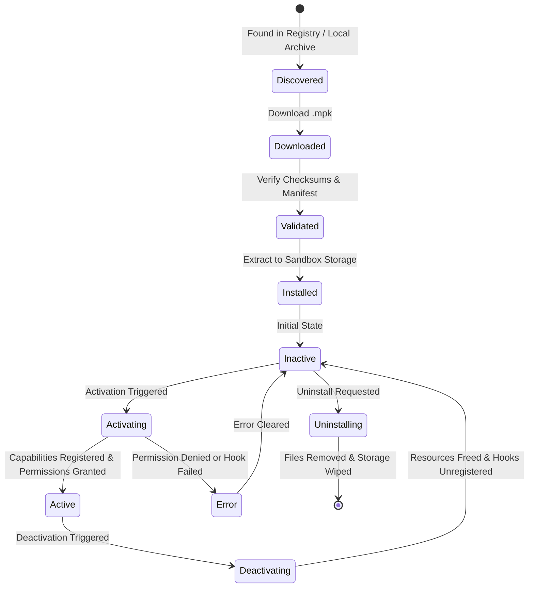

# Universal Plugin Ecosystem — Architecture Overview

## 1. System Vision & Purpose

The **Universal Plugin Ecosystem** enables optional, modular extensions to run across diverse official community clients without altering the platform's mandatory core services or creating lock-in to a single client technology stack.

```
+-----------------------------------------------------------------------------------------+
|                                    COMMUNITY PLATFORM                                   |
|                                                                                         |
|  +-----------------------------------------------------------------------------------+  |
|  |                 MANDATORY CORE SERVICES (Partisier-Rewritten)                     |  |
|  |  [auth-service]  [user-service]  [media-service]  [group-service]  [api-gateway]  |  |
|  +-----------------------------------------------------------------------------------+  |
|                                           |                                             |
|                                           v                                             |
|  +-----------------------------------------------------------------------------------+  |
|  |                             OFFICIAL CLIENTS                                      |  |
|  |  +--------------------+  +--------------------+  +-----------------------------+  |  |
|  |  |  Glacier (Web)     |  |  Matcha (React     |  |  Kiirohana (Cordova/Hybrid) |  |  |
|  |  |  React / Vite / TS |  |  Native / Expo)    |  |  Web + Cordova Native       |  |  |
|  |  +--------------------+  +--------------------+  +-----------------------------+  |  |
|  |           |                        |                           |                  |  |
|  |           +------------------------+---------------------------+                  |  |
|  |                                    |                                              |  |
|  |                                    v                                              |  |
|  |  +-----------------------------------------------------------------------------+  |  |
|  |  |                      SHARED CLIENT EXTENSION CONTRACT                       |  |  |
|  |  |  [Package Validator] [Local Plugin Manager] [Sandboxed Host Bridge]         |  |  |
|  |  |  [Capability Broker] [JSON-RPC 2.0 Router]  [Namespaced State Engine]       |  |  |
|  |  +-----------------------------------------------------------------------------+  |  |
|  +-----------------------------------------------------------------------------------+  |
|                                           |                                             |
|                                           v                                             |
|  +-----------------------------------------------------------------------------------+  |
|  |                       OPTIONAL PLUGIN ARTIFACTS (.mpk)                            |  |
|  |  [Mini-Games / Embedded UI]  [Jellyfin/Plex Connector]  [Naviah Sync Adapter]   |  |
|  +-----------------------------------------------------------------------------------+  |
+-----------------------------------------------------------------------------------------+
```

---

## 2. Core Platform Boundaries

The ecosystem enforces an inviolable separation between **Mandatory Core Platform Services** and **Optional Plugins**:

| Aspect | Mandatory Core Platform | Optional Plugin System |
|---|---|---|
| **Ownership** | Core engineering team; `Partisier-Rewritten` core microservices | Community, third-party publishers, or ecosystem team |
| **Services** | Auth, user profiles, community chat, media catalog, shorts, notifications | Mini-games, Jellyfin/Plex connectors, Naviah Sync, custom dashboard widgets |
| **Failure Impact** | System outage if down | Graceful degradation; only affected plugin is disabled |
| **Modification** | Governed by platform release cycles | Installed, updated, or removed independently at runtime |
| **API Access** | Platform-level JWT & RBAC enforcement | Brokered through `Capability Broker` with least-privilege grants |

Plugins **cannot**:
- Replace or disable core authentication or user account flows.
- Intercept platform credentials, master JWTs, or sensitive session data.
- Modify core media catalog schemas or database entities.
- Inject arbitrary UI into non-approved core navigation routes.

---

## 3. Subsystems & Component Architecture

### 3.1 Plugin Registry and Store (Distribution Layer)
- **Role**: Remote catalog for plugin discovery, version management, and distribution.
- **Components**:
  - `Registry API`: Search, pagination, categorized browsing, manifest metadata.
  - `Package Repository`: Content-addressable storage for `.mpk` archive files.
  - `Attestation & Signature Service`: Verifies publisher Ed25519 signatures and security audit flags.
  - `Compatibility Engine`: Evaluates client engine constraints (e.g., `client.android >= 2.1`) prior to offering download.

### 3.2 Local Plugin Manager (Client Host Layer)
- **Role**: Manages the local plugin lifecycle on a specific client device.
- **Responsibilities**:
  - `Archive Unpacker`: Securely verifies SHA-256 digests and unpacks `.mpk` archives into local isolated directories.
  - `Manifest Validator`: Validates `plugin.json` against JSON Schema.
  - `Permission Store`: Persists user consent and capability grants per plugin.
  - `Dependency Resolver`: Checks required platform versions and peer plugin dependencies.
  - `State Persistence`: Maintains plugin enabled/disabled flags, error state, and usage metrics.

### 3.3 UI Integration & Sandbox Engine
- **Sandboxed WebView / iframe**:
  - Sandboxed execution context with opaque origin (`null`).
  - No access to host DOM, `window.localStorage`, or `document.cookie`.
  - Host renders plugin inside designated UI slots:
    - **Namespaced Route**: `/ext/:pluginId/:route`
    - **Host Widget**: Pinned to community feed or side panel.
    - **Action Menu**: Injected into user-permitted context menus.
- **Message Bridge**:
  - Bidirectional communication using `window.postMessage` / `MessageChannel`.
  - Transport layer for JSON-RPC 2.0 requests.

### 3.4 Capability Broker (Host Mediator)
- **Role**: Gatekeeper for all host resources and system capabilities.
- **Workflow**:
  1. Plugin sends a JSON-RPC 2.0 request (`capability.invoke`).
  2. Broker validates the channel identity and manifest grants.
  3. Broker checks rate limits, quotas, and invocation parameters.
  4. Broker delegates execution to the registered **Capability Provider**.
  5. Broker returns sanitized result or standard error code.

```
Plugin Context (Untrusted)             Capability Broker (Trusted Host)         Provider / Native OS
       |                                             |                                   |
       |--- 1. JSON-RPC (storage.local.get) -------->|                                   |
       |                                             |--- 2. Verify grant & quota ------>|
       |                                             |<-- 3. Grant valid ----------------|
       |                                             |--- 4. Query namespaced storage -->|
       |                                             |<-- 5. Storage record returned ----|
       |<-- 6. JSON-RPC Result ----------------------|                                   |
```

---

## 4. Plugin Lifecycle State Machine

A plugin transitions through explicit, deterministic lifecycle states:



### Lifecycle Hooks:
- `onInstall`: Executed once when plugin is unpacked.
- `onActivate`: Executed when user or system enables the plugin. Sets up subscriptions and background connections.
- `onDeactivate`: Executed when plugin is paused or disabled. Cleans up timers, cancels active sync, closes sockets.
- `onUninstall`: Executed prior to removal. Emits cleanup signal and deletes isolated storage.

---

## 5. Security & Isolation Matrix

| Threat Vector | Defense Mechanism | Enforcement Point |
|---|---|---|
| **Credential Theft** | Plugins have zero access to platform JWTs or cookies; all host auth remains in host HTTP-only storage. | Architecture & Sandboxed Iframe/WebView |
| **DOM Hijacking / Clickjacking** | Plugins run with `sandbox="allow-scripts"` without `allow-top-navigation` or `allow-same-origin`. | Browser / OS WebView engine |
| **Path Traversal / Zip Slip** | Plugin manager rejects archive files containing `..`, absolute paths, or symlinks. | Local Plugin Manager Archive Unpacker |
| **Resource Exhaustion** | Storage quotas (e.g. 10MB default), CPU throttling, execution timeouts (10s default per RPC call). | Capability Broker & Storage Engine |
| **Rogue Network Traffic** | External requests proxied via broker; domain whitelisting enforced per manifest declaration. | Capability Broker Network Provider |
| **Unauthorized Native Calls** | No dynamic binary loading (`.so` / `.dylib`); only host-precompiled providers accessible via broker. | Client Native Bridge & Broker |

---

## 6. Cross-Client Compatibility Strategy

To ensure equitable support across all official clients:

1. **Shared Specification**: All clients share the exact same JSON Schema for manifests and JSON-RPC 2.0 broker contracts.
2. **Platform-Neutral Reference Adapter**:
   - Reference implementation written in TypeScript (`@miyuna/plugin-core` / `@miyuna/plugin-bridge`).
   - Usable directly by **Glacier** (React/Vite), **Hanatsuki** (React/Vite), and **Kiirohana** (Cordova WebView).
   - Ported or bridged to React Native for **Matcha**, and mapped to native interfaces for future clients (Flutter/Kotlin).
3. **Graceful Capability Querying**:
   - Plugins use `broker.getCapabilities()` to dynamically detect available providers (e.g., detecting if `device.naviah-sync` is present on the current client).
   - Unsupported capabilities fail with explicit `CAPABILITY_UNSUPPORTED` error codes rather than unhandled crashes.
